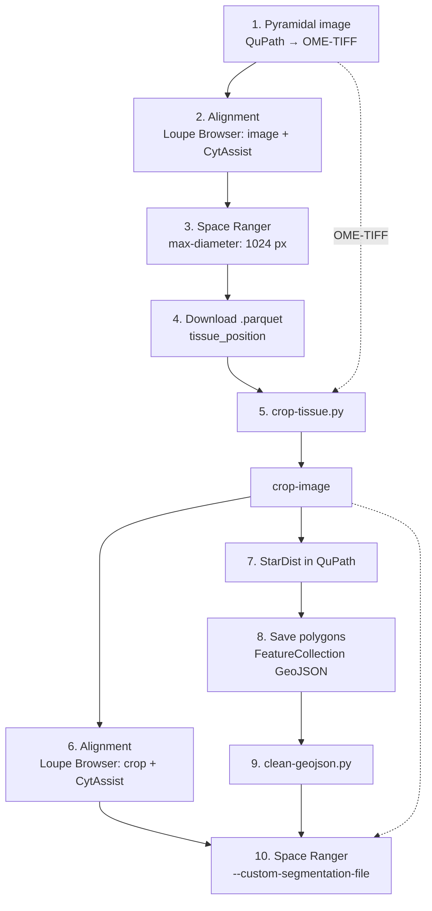

# Benchmarking of Segmentation Tools for Spatial Transcriptomics

> Repository for my internship project. The goal is to **benchmark several tools** within a single spatial transcriptomics workflow, using histology images aligned with **CytAssist** images and processed with **Space Ranger**.

<!-- Author: Lucía Santos Muñoz, Institution: Centro Nacional de Investigaciones Oncológicas (CNIO) -->

---

## 1. What is this internship about?

During my internship I am evaluating different segmentation tools (and the way the image and annotations are prepared) with spatial transcriptomics data.

The aim is to reach a **consensus on the best possible result**, taking into account the baseline quality of the images. To do so, several approaches are tested and compared.

## 2. Tools

| Tool | Role in this project |
|---|---|
| **QuPath** | Visualization of the images, conversion to pyramidal image (OME-TIFF) and segmentation with StarDist |
| **Loupe Browser** | Manual alignment of the H&E image with the CytAssist image |
| **Space Ranger** | Processing of the spatial data |
| **StarDist** | Nuclei segmentation (tool under evaluation) |
| **Python scripts** (`crop-tissue.py`, `clean-geojson.py`) | Image cropping and GeoJSON cleaning |
| **Cellpose** | Nuclei segmentation (tool under evaluation) |
| **SMURF** | Cell soft segmentation (tool under evaluation) |
| **CellViT++** | Nuclei segmentation (tool under evaluation) |

## 3. Workflows

### 3.1. Space Ranger

The first segmentation tool tested was Space Ranger itself. It can be used in two ways: through the web interface or from the command line. Both achieve the same results, but the web interface takes less time than the command line.

<!-- TODO: add the link to the web interface -->

Space Ranger only accepts the histology image if it is **pyramidal**. To get one, the original image is loaded in QuPath, which converts it to a pyramidal image when reading it. It is then exported to keep this format (*Export images → OME-TIFF*). This OME-TIFF is the image used both for the alignment and as the Space Ranger input.

#### Web interface

<!-- TODO: add the usage diagram -->

The inputs are the FASTQ files, the microscopy (histology) image and the CytAssist image. A new analysis is created and, under *advanced options*, the **maximum diameter is set to 1024 pixels**, because the tissue contains muscle cells, which are large. A `.json` file with the fiducial alignment between the CytAssist image and the original image is also added there; this alignment is done beforehand and manually in Loupe Browser.

#### Command line with `--custom-segmentation-file`

<!-- TODO: add the usage diagram -->

This option lets you **expand a segmentation that was already generated with another tool**, and it returns the run metrics.

```bash
spaceranger count \
  --id=<run_id> \
  --transcriptome=<reference_transcriptome> \
  --fastqs=<fastq_folder> \
  --probe-set=<probe_set_csv> \
  --cytaimage=<cytassist_image> \
  --image=<histology_image_ome_tiff> \
  --loupe-alignment=<alignment_json> \
  --create-bam=false \
  --custom-segmentation-file=<segmentation_geojson> \
  --nucleus-expansion-distance-micron=8
```

| Flag | Meaning |
|---|---|
| `--id` | Name of the run (and of its output folder) |
| `--transcriptome` | Reference transcriptome (here GRCh38-2024-A) |
| `--fastqs` | Folder with the FASTQ files |
| `--probe-set` | Probe set CSV of the Visium human transcriptome panel (v2.1.0 here) |
| `--cytaimage` | CytAssist image |
| `--image` | Pyramidal histology image (OME-TIFF) |
| `--loupe-alignment` | JSON with the manual fiducial alignment exported from Loupe Browser |
| `--create-bam` | Set to `false` to skip BAM generation |
| `--custom-segmentation-file` | GeoJSON `FeatureCollection` of `Polygon` features with the external segmentation |
| `--nucleus-expansion-distance-micron` | Distance (µm) by which each nucleus is expanded to define the cell (8 here) |

On the cluster it is launched through `sbatch` (`--wrap`), with 2 cores, 50 GB of memory and a 24 h time limit.

### 3.2. CellViT++ - custom segmentation in Space Ranger

To test CellViT++ we used a GeoJSON that had already been generated, but it had to be processed to meet the input requirements of Space Ranger. The file must be a `FeatureCollection` made of **polygons**, whereas the CellViT++ mask was segmented as **points and multipoints**.

The fix is to load the mask in QuPath and export it as objects in `FeatureCollection` format. This `.geojson` is then cleaned with `clean-geojson.py`.

<!-- TODO: add the link to clean-geojson.py -->
<!-- TODO: add the usage diagram -->

With this segmentation, metrics such as **UMIs in cells** decreased compared to the default Space Ranger segmentation, which uses StarDist as its segmentation engine.

### 3.3. Cellpose

<!-- TODO: complete with how the masks are converted to GeoJSON polygons -->

Nuclei are segmented with Cellpose on the GPU, using the first three channels of the H&E image. Parameters used:

- `flow_threshold = 0.4`
- `cellprob_threshold = 0.0`
- `tile_norm_blocksize = 0`
- `batch_size = 32`

Notes:

- With this image, Cellpose returned more than 65535 masks.
- Executing right now

### 3.4. SMURF

<!-- TODO: add the usage diagram and links to the scripts -->

SMURF takes a nuclei segmentation that was already generated (here, the nuclei mask produced by Space Ranger segment) together with the 2 µm bin data, and builds a **soft segmentation of the cells**: the counts of the spots that overlap several cells are distributed among them.

Main steps:

1. Build the spatial object from the tissue positions and the H&E image, and load the nuclei mask.
2. Compute which 2 µm spots overlap each nucleus, and build the nuclei × genes matrix.
3. Cluster the nuclei and refine the assignment iteratively.
4. Prepare the data and optimize the spot-to-cell weights (this step can use the GPU through PyTorch; for this sample it also completed on CPU).
5. Build the final cell × gene matrix with **all genes** (the optimization uses only genes with at least 1000 counts).

### 3.5. StarDist extension in QuPath

#### Diagram



Original hand-drawn sketch (annotated in Spanish):


The same workflow applies to the other tools: only step 7 (the segmentation) changes.

#### Step-by-step explanation

**Phase 1: full image and tissue detection**

1. **Pyramidal image with QuPath.** The tissue photo is converted to a pyramidal format and exported as **OME-TIFF** (*Export images → OME-TIFF*). This image is reused later in the cropping step.
2. **Initial alignment in Loupe Browser.** The image is aligned with the **CytAssist** image.
3. **First Space Ranger run.** It is launched with `max-diameter: 1024 px`. The *web summary* is then reviewed to check that the output is correct.
4. **Download the `.parquet` file.** The file with the tissue positions (`tissue_position`) is downloaded from the Space Ranger output.

**Phase 2: cropping and custom segmentation**

5. **Cropping with `crop-tissue.py`.** The script uses the `.parquet` file with the tissue positions and the OME-TIFF image from step 1 to generate the cropped image (`crop-image`).
6. **New alignment in Loupe Browser.** The cropped image is aligned with CytAssist. This alignment is used in the final run.
7. **Segmentation with StarDist in QuPath.** It is applied to the cropped image.
8. **Polygon export.** The segmented objects are saved as **GeoJSON** (`FeatureCollection`).
9. **Cleaning with `clean-geojson.py`.** The GeoJSON is processed so that it has a valid format for Space Ranger.
10. **Space Ranger with custom segmentation.** It is run with `--custom-segmentation-file`, combining the alignment from step 6, the cropped image and the cleaned GeoJSON from step 9.

## 4. Repository structure

```
.
├── README.md
├── docs/
│   └── esquema_workflow.jpeg
├── scripts/
│   ├── crop-tissue.py
│   └── clean-geojson.py
└── ...
```

<!-- TODO: update the tree with the actual structure -->

## 5. Requirements

- QuPath (with the StarDist extension)
- Loupe Browser
- Space Ranger
- Python 3 (with the scripts' dependencies)

<!-- TODO: specify versions and add a requirements.txt / environment.yml -->

## 6. Benchmark results

<!-- TODO: table or figures comparing the tools -->

## 7. Author and license

<!-- TODO: author, contact and license -->
